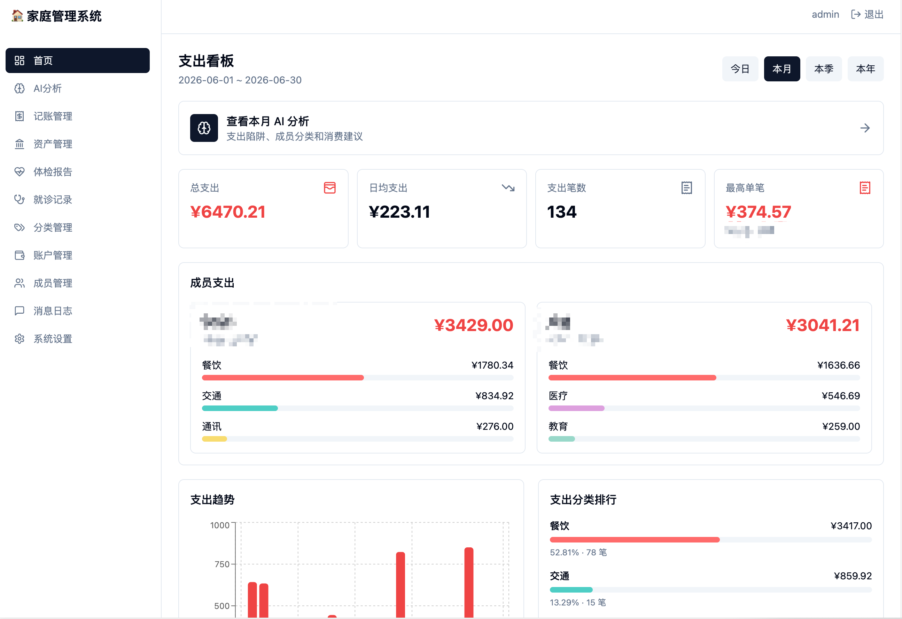
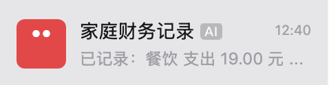
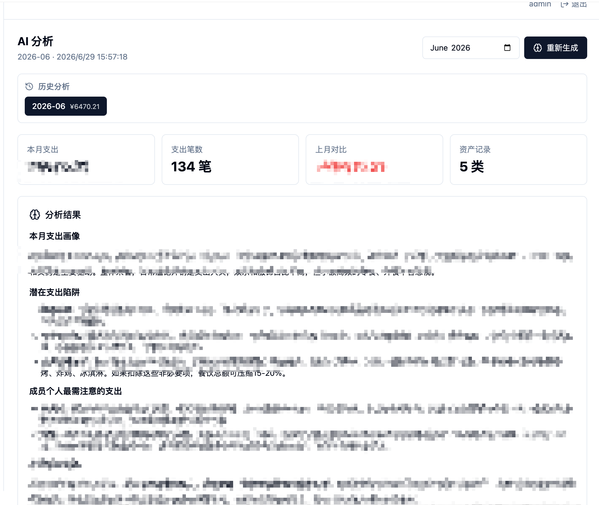
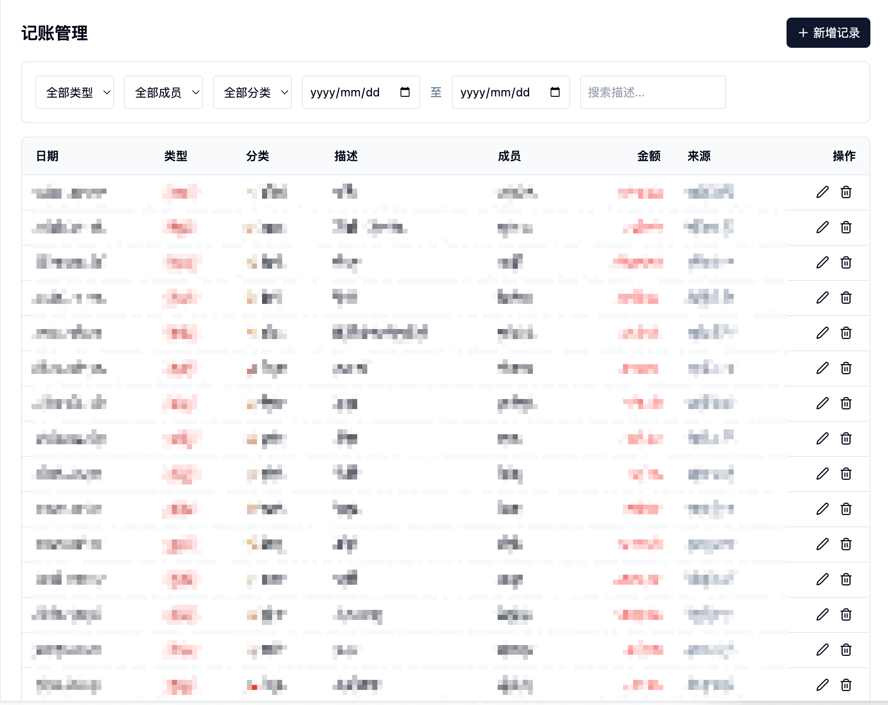
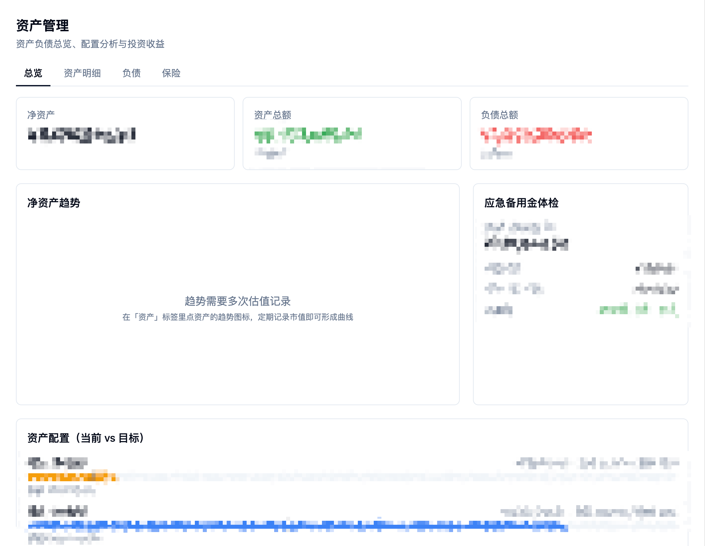
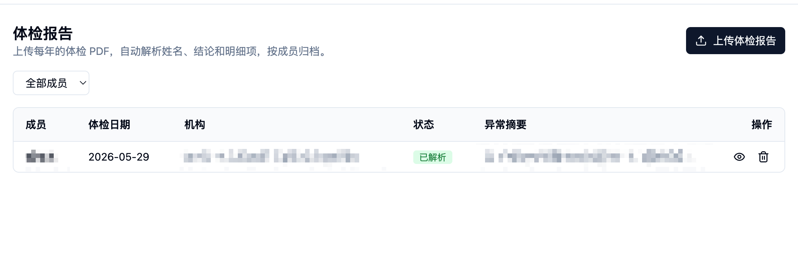
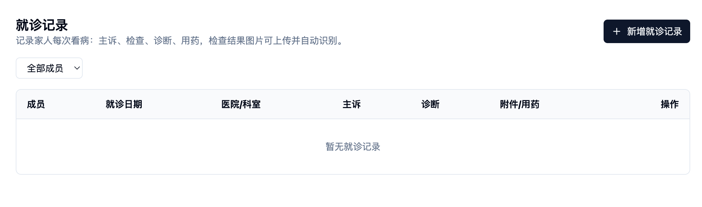

# 家庭管理系统 · family-manager

> 一个**自托管 / 数据私有化**的家庭管理系统：把家里的财务、资产、健康记录统一管起来，
> 并打通微信，用一句话 + AI 自动录入。所有数据只存在你自己的服务器 / NAS 上。

<p align="center">
  
  
  
  
</p>

<p align="center">
  
</p>

## 🎯 为什么做这个

记账工具的核心能力只有一个：**更低的记录摩擦**。

大部分记账 App 失败的地方不是功能不够，而是每记一笔都要先想「这算哪个类目」。
所以这个项目从一开始就定了三条：

- **入口要好找** —— 不新装 App，直接在微信里对着机器人说话。
- **录入要随意** —— 只要说清「买了什么、多少钱」就够，类目交给模型判断。
- **格式要兼容** —— 文字、语音、微信/支付宝支付截图，都能直接扔进去。

记账跑通之后自然往外扩：既然消费能记，资产负债、保险、体检报告、就诊记录也一起记。
人最容易遗忘，把真实数据摆在眼前，才谈得上分析和判断。

> 完整的设计思路见博客：[基于 AI 的家庭管理系统实践](https://blog.askcheng.xyz/posts/38e756294a7180958358d3877590aeb4/)

## 📸 界面预览

### 微信里说一句，就记好了



发一句「午饭 19」，机器人回一条回执：`已记录：餐饮 支出 19.00 元`。
语音消息由 Hub 侧直接转成文字；图片走多模态模型一步解析，**不需要先 OCR 再理解**。

### 支出看板


按今日 / 本月 / 本季 / 本年切换，总支出、日均、笔数、最高单笔，以及**按家庭成员拆分**的分类支出、
支出趋势与分类排行。

### 月度 AI 分析



按月生成，可随时重新生成并保留历史。输出分三块：本月支出画像、潜在支出陷阱、成员个人最需注意的支出。
提示词可以在后台自己改 —— 写得太毒舌会有心理负担，慎重。

### 记账管理



微信录入的记录不是黑盒，可以按类型 / 成员 / 分类 / 日期 / 关键词筛选，逐条改或删，也能手动补录。
`来源` 列会标明这笔是微信进来的还是手动录的。

### 资产管理



总览 / 资产明细 / 负债 / 保险 四个页签。净资产、资产总额、负债总额，
加上**应急备用金体检**和**资产配置（当前 vs 目标）**对照。定期记一次估值就能形成净资产趋势曲线。

### 健康档案



上传每年的体检 PDF，自动解析姓名、结论和明细项，按成员归档，异常项单独摘要。



就诊记录记主诉、检查、诊断、用药，检查结果图片可上传并自动识别。
这类信息不是每天变化，所以没有接微信，直接在系统里结构化录入。

## ✨ 特性

- **🏠 家庭全方位管理**，不止于记账：
  - 记账收支、资产管理（工资 / 投资 / 保险等）
  - 健康档案：体检报告按成员归档、自动解析结论与异常项；就诊记录（主诉 / 检查 / 诊断 / 医嘱 / 用药）
  - 分类、账户、家庭成员统一管理
- **💬 打通微信，AI 一句话录入**：在微信里发「午饭花了 35」「收到工资 15000」，
  经 [OpenILink Hub](https://github.com/openilink/openilink-hub) 转发，AI 自动解析金额、类型、分类并入账。
  支持图片小票 / 截图识别（视觉模型直接解析）。
- **👨‍👩‍👧 多成员共用一个后端**：家里每个人的微信都可以绑到同一个服务，账目自动归到对应成员名下。
- **🔒 数据私有化 / 自托管**：SQLite 单文件存储，跑在你自己的服务器或 NAS（飞牛 / 群晖 / 任意 Docker 主机）上，
  数据不经过任何第三方云。
- **🤖 月度 AI 分析**：每月自动聚合并生成家庭财务分析报告，可推送回微信。
- **📱 响应式后台**：桌面 + 手机端都可用的管理界面。

## 🔄 数据是怎么流的

```
微信消息（文字 / 语音 / 图片）
      │
      ▼
OpenILink Hub          ← 语音在这一步已转成文字
      │  webhook（HMAC 签名）
      ▼
本服务 /hub/webhook
      │
      ├── 文字 → DeepSeek 解析
      │           提示词里会注入你**当前的分类列表**和业务时区日期规则
      │
      └── 图片 → 阿里云百炼 qwen3-vl 多模态直接出结构化结果
      │
      ▼
结构化数据入库（SQLite）
      │
      ▼
微信回执：已记录：餐饮 支出 19.00 元
```

几个实现上的取舍：

- **解析提示词存在数据库里**（`系统设置 → AI`），改完即时生效，不用重新部署。
- **提示词会动态注入当前分类列表**，所以你新增一个分类，模型下一条消息就认得。
- **图片以 base64 内联发给视觉模型**，不传 URL —— 因为 Hub 的媒体地址通常是内网 NAS 地址且带一次性
  token，云端模型服务器根本取不到。代价是受模型侧约 10MB 的内联体积限制。

## 🧱 技术栈

| 层 | 技术 |
|----|------|
| 前端 | React 19 · React Router 7 · Vite 6 · Tailwind CSS |
| 后端 | Fastify 5 · Drizzle ORM · SQLite (better-sqlite3 11) |
| AI | DeepSeek（文本解析 / 分析）· 阿里云百炼 DashScope（图片识别，可选） |
| 微信网关 | [OpenILink Hub](https://github.com/openilink/openilink-hub) |
| 部署 | Docker / docker-compose |

monorepo（pnpm）结构：`apps/backend`、`apps/frontend`、`packages/shared`。

## 📋 前置要求

| | 版本 | 说明 |
|---|---|---|
| Node.js | **≥ 20**（推荐 22，镜像用的就是 `node:22-alpine`） | |
| pnpm | **≥ 9** | 仓库的 `pnpm-lock.yaml` 是 `lockfileVersion: 9.0`，**pnpm 8 会直接装不上** |
| C/C++ 构建工具链 | python3 / make / g++ | `better-sqlite3` 是原生模块，没有匹配的预编译包时需要现场编译 |
| Docker | 24+（含 compose v2 插件） | 仅自托管部署需要 |

推荐用 corepack 固定 pnpm 版本，避免版本漂移：

```bash
corepack enable && corepack prepare pnpm@10.15.0 --activate
```

## 🚀 快速开始

### 本地开发

```bash
pnpm install
cp .env.example .env        # 至少改掉 JWT_SECRET / ADMIN_PASSWORD
pnpm dev                    # 前端 :5173（代理 API 到后端 :3000）
```

数据库默认落在仓库下的 `./data/caiwu.db`，目录会自动创建。

### Docker 自托管部署

```bash
cp .env.example .env
# 生成强随机密钥与管理员密码
#   JWT_SECRET=$(openssl rand -hex 32)
#   ADMIN_PASSWORD=$(openssl rand -base64 18 | tr -d '/+=' | head -c 16)
docker compose up -d --build
```

启动后访问 `http://<服务器IP>:3000`，用 `.env` 里的 `ADMIN_USERNAME` / `ADMIN_PASSWORD` 登录。
数据库持久化在挂载卷 `./data` 中，重建容器不丢数据。

> ⚠️ **备份提醒**：SQLite 启用了 WAL 模式，请务必把 `caiwu.db`、`caiwu.db-wal`、`caiwu.db-shm`
> 三个文件**一起**备份，只复制主文件会丢失最新数据。

## ⚙️ 配置

运行时配置来自两处：

1. **环境变量**（`.env`，见 [`.env.example`](.env.example)）——端口、数据库路径、JWT 密钥、管理员账号、AI 默认值、Hub 地址。
2. **系统设置表**（SQLite，后台「系统设置」页面）——AI 配置、提示词、月报计划。设置项会覆盖对应的环境变量。

| 变量 | 说明 |
|------|------|
| `DATABASE_PATH` | SQLite 文件路径，默认 `./data/caiwu.db`（容器内 WORKDIR 为 `/app`，等价于 `/app/data/caiwu.db`） |
| `JWT_SECRET` | **务必改成随机字符串** |
| `ADMIN_USERNAME` / `ADMIN_PASSWORD` | 后台管理员账号，**务必修改默认值** |
| `DEEPSEEK_API_KEY` | DeepSeek API Key，用于文本解析与 AI 分析 |
| `DASHSCOPE_API_KEY` | （可选）阿里云百炼，用于图片小票识别 |
| `HUB_URL` / `BASE_URL` | OpenILink Hub 地址与本服务回调地址 |

## 💬 接入微信录入（可选）

1. 部署 [OpenILink Hub](https://github.com/openilink/openilink-hub)（本仓库 `deploy/openilink-hub/` 提供了一份 docker-compose 模板）。
2. 在 Hub 创建机器人应用，拿到 App / Bot / Secret 信息。
3. 把 Webhook 回调设为 `https://<你的域名>/hub/webhook`（微信回调需 HTTPS）。
4. 在后台「系统设置」填入 Hub 地址即可。

之后在微信里直接对机器人说话即可记账，内置 `/help`、`/recent`、`/balance` 命令。

## ❓ 常见问题

<details>
<summary><b>装依赖就失败：<code>ERR_PNPM_LOCKFILE_BREAKING_CHANGE</code> 或 lockfile 版本不兼容</b></summary>

pnpm 版本太老。锁文件是 `lockfileVersion: 9.0`，需要 pnpm ≥ 9：

```bash
corepack enable && corepack prepare pnpm@10.15.0 --activate
```
</details>

<details>
<summary><b><code>pnpm install</code> 卡在 better-sqlite3 / node-gyp 编译报错</b></summary>

`better-sqlite3` 是原生模块。当前平台没有对应预编译包时会现场编译，需要构建工具链：

- Debian/Ubuntu：`sudo apt-get install -y python3 make g++`
- Alpine：`apk add --no-cache python3 make g++`
- macOS：`xcode-select --install`

如果只是想跑起来，直接用 Docker 部署可以完全绕开这一步。
</details>

<details>
<summary><b>本地 <code>pnpm dev</code> 起不来，报 <code>EACCES: permission denied, mkdir '/app'</code></b></summary>

早期版本的 `.env.example` 里 `DATABASE_PATH` 写的是容器内绝对路径 `/app/data/caiwu.db`，
拿到本机就会去创建 `/app`。当前版本已改为相对路径。

如果你的 `.env` 是从旧版复制的，把这一行改成（或直接删掉，代码有同样的默认值）：

```dotenv
DATABASE_PATH=./data/caiwu.db
```
</details>

<details>
<summary><b><code>docker compose up --build</code> 拉包超时 / 卡住</b></summary>

`Dockerfile` 默认写死了国内镜像源（npmmirror + 清华 Alpine 源），**在中国大陆以外会很慢甚至超时**。
如果你不在国内，把 `Dockerfile` 里这几行去掉即可：

```dockerfile
ENV NPM_CONFIG_REGISTRY=https://registry.npmmirror.com
ENV NPM_CONFIG_DISTURL=https://npmmirror.com/mirrors/node
RUN sed -i 's|dl-cdn.alpinelinux.org|mirrors.tuna.tsinghua.edu.cn|g' /etc/apk/repositories \
```
</details>

<details>
<summary><b>图片记账没反应 / 只认文字不认截图</b></summary>

图片识别走阿里云百炼，是可选能力，需要单独配置。
`docker-compose.yml` 目前没有透传 `DASHSCOPE_*` 环境变量，
所以 Docker 部署下请在后台 **「系统设置 → 图片识别」** 里填 Key 和模型（`vision.*` 设置项会覆盖环境变量）。

另外注意图片体积：内联给模型的上限约 10MB。
</details>

<details>
<summary><b>忘记管理员密码了</b></summary>

改 `.env` 里的 `ADMIN_PASSWORD` 后重启服务即可。

管理员账号并不落库，登录时直接和环境变量比对，所以没有「找回密码」流程，也不存在改不掉的情况。
反过来说：**`.env` 必须妥善保管，不要提交到版本库**。
</details>

## 🙏 致谢

- **[OpenILink Hub](https://github.com/openilink/openilink-hub)** —— 本项目的微信消息录入能力依赖它作为消息网关，
  在此特别致谢。
- [DeepSeek](https://platform.deepseek.com) 提供语义解析与分析能力。
- 阿里云百炼 DashScope 提供图片识别能力。

## 📄 许可证

[MIT](LICENSE)

---

> 本仓库为开源版本，**不包含任何真实家庭数据、密钥或私有部署信息**。
> README 中的截图均已对姓名与金额做模糊处理。
> 请自行准备 `.env` 与数据库，所有敏感数据保存在你自己的部署环境中。
